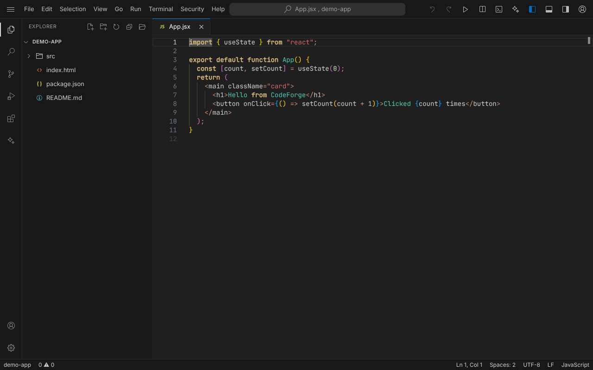
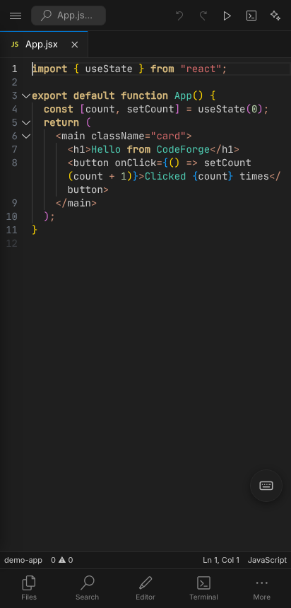
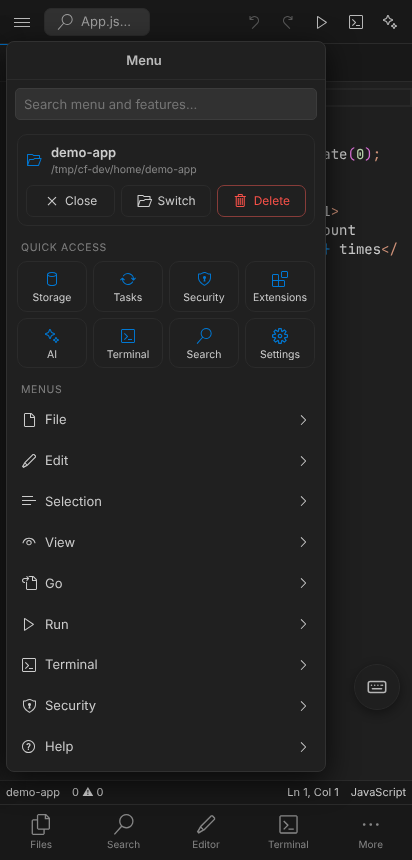

<div align="center">


# CodeForge

**A real code editor and IDE for Android, with a web version. Monaco editor, Linux terminal, Git, live preview, VS Code extensions and AI agents in your pocket.**

[](https://github.com/saurabhart111/codeforge/stargazers)
[](https://github.com/saurabhart111/codeforge/actions)
[](LICENSE)
[](#install)
[](#web-version)
[](app/src/main/java/dev/codeforge/ide)
[](https://microsoft.github.io/monaco-editor/)

[Releases](https://github.com/saurabhart111/codeforge/releases) · [Issues](https://github.com/saurabhart111/codeforge/issues) · [Build guide](BUILD.md) · [Deploy the website](DEPLOY.md)

<br />

[](https://github.com/saurabhart111/codeforge/releases)

<br />

[Quick start](#quick-start) · [Screenshots](#screenshots) · [What's inside](#whats-inside) · [AI editing](#ai-and-cli-editing) · [Extensions](#vs-code-extensions) · [Web version](#web-version) · [Security](#security-and-storage) · [Limitations](#honest-limitations) · [Layout](#project-layout)

```sh
./gradlew assembleDebug
```

</div>

> [!IMPORTANT]
> **Only install CodeForge from this repository.** Download APKs from the [Releases](https://github.com/saurabhart111/codeforge/releases) page or build them yourself from source. CodeForge asks for powerful permissions (all-files access, a terminal, API keys), so do not install copies from other websites, chat groups or mirrors.

<div align="center">

</div>

## Screenshots

<div align="center">

&nbsp;&nbsp;

</div>

*The menu on a phone: the open project with Close / Switch / Delete, one-tap access to Storage, Background Tasks, Security, Extensions, AI, Terminal, Search and Settings, a search box for every command, then the usual File / Edit / View menus.*

## Quick start

| You want to… | Do this |
|---|---|
| **Use it on a phone** | Install the APK from [Releases](https://github.com/saurabhart111/codeforge/releases), open the app, choose **Open Folder** and pick a project (or **New project**, **Clone repo**, **Open ZIP**). |
| **Build the Android app** | `./gradlew assembleDebug`. See [BUILD.md](BUILD.md) for the SDK, NDK and signing details. |
| **Run it in a browser** | `sh tools/web/build.sh` writes a static PWA to `web-dist/`. Serve it over HTTPS (or `localhost`). See [Web version](#web-version). |
| **Hack on the UI** | `cd tools/devhost && npm install && sh restart.sh`, then open `http://127.0.0.1:8780`. The dev host emulates the native bridge with plain Node. |
| **Run the tests** | `node tools/e2e/v85.js` (needs Playwright). More suites live in `tools/e2e/`. |

## What's inside

| | |
|---|---|
| **Editor** | Monaco with tabs, split view, diff, find/replace, multi-file search, Emmet, VS Code snippets and language configs, Prettier formatting, VS Code themes, file icons. |
| **Terminal** | Native PTY sessions. An Android shell by default, or a full **Alpine Linux via proot** with `git`, `node`, `npm`, `python`, `gcc` and `apk`. Extra-keys bar, pinch zoom, touch scrolling. |
| **Run and preview** | Run files by extension, `package.json` scripts, `tasks.json`. A live server with hot reload and an in-app preview (device presets, console). Previews run in a **separate process**, so a heavy page cannot crash the editor. |
| **Git and GitHub** | Clone, stage, commit, branches, log, diff, pull, push. Sign in with a token or OAuth device flow. Tokens are injected natively and never reach scripts. |
| **AI assistant** | Chat and an agent mode with file tools, plus Claude Code, Codex, Gemini, Copilot and other CLIs inside the app. Works with OpenAI, Anthropic, Google, OpenRouter, Groq, Mistral, DeepSeek, xAI, Ollama or any OpenAI-compatible endpoint. |
| **Extensions** | Install from Open VSX or a `.vsix`. Every extension gets a **compatibility report**. See [VS Code extensions](#vs-code-extensions). |
| **Files and storage** | All-files access, a document provider (the Files app can see your workspace), ZIP open / extract / compress, export to Downloads, a **Storage Manager** that shows what uses space. |
| **Background tasks** | Downloads, installs, ZIP exports and cleanups run as tasks with progress and notifications, so the editor never blocks. |
| **Security** | A Security Centre, PIN and biometric lock, API keys in the Android Keystore, privacy cleanup. See [Security and storage](#security-and-storage). |
| **Crash recorder** | Uncaught Kotlin and JS errors, renderer deaths and out-of-memory kills are saved on the device with a stack, memory state and recent actions. |
| **Touch workbench** | Draggable sashes with big touch targets, long-press menus, dockable top and bottom sheets, a drill-in phone menu, text size from 70 % to 170 % for the whole UI. |

## AI and CLI editing

Edits made by the AI agent, by a pasted `FILE:` block, or by a CLI tool running in the terminal (Claude Code, Codex, Gemini) behave like edits you typed yourself:

- **In place.** Only the changed lines are touched, so your cursor, folds, scroll position and syntax state stay where they were.
- **One undo step.** `Ctrl+Z` takes a whole AI change back.
- **Visible.** Changed lines flash and show in the overview ruler; the agent can open the files it edits so you watch the change appear (*Settings → AI Assistant → Open the files the agent edits*).
- **Review in an editor tab.** Proposed changes open as a side-by-side diff in a normal tab (stacked on phones). Edit the right-hand side, revert single hunks, then **Apply** or **Reject**. A dialog review is still available in settings.
- **Live from disk.** While an agent or a Linux-terminal CLI is working, CodeForge checks open files every 1.5 seconds. Clean files update in place. If you have unsaved changes in a file that changed on disk, you choose **Keep mine**, **Compare** or **Use the disk version**; nothing is discarded silently.

The same code path serves the Android app and the web version.

### The agent's own terminals

In **Agent** mode the assistant works in a shell the way Claude Code or Codex do:

- **Several terminals.** It opens one per job (`dev-server`, `tests`, `install` …). They show up as terminal tabs marked with a sparkle, so you can watch them or take over. Commands in different terminals run at the same time.
- **A real shell.** Each terminal keeps its state (`cd`, exported variables, virtualenvs). The agent runs commands and gets the output and exit code, starts servers in the background and checks on them later, answers prompts (`y/N`), and presses Ctrl+C.
- **Its own tools.** It can check what is installed, set up the Linux environment, and install tools and libraries with `apk`, `npm` or `pip`, after asking you.
- **You stay in control.** *Settings → AI Assistant → Terminal access*: **ask** (confirm each command, or allow all for one chat), **auto** (no prompts; risky commands such as `rm -rf /`, `curl … | sh`, force-push and `git reset --hard` still ask) or **off**. Your own terminals are read-only for the agent.

Real Claude Code, Codex, Gemini and other CLIs still run as full tools in their own tabs (*AI side bar → CLIs*).

## VS Code extensions

CodeForge uses the **Monaco** editor with its own interface. It is not a fork of the VS Code workbench, and it has no Node.js extension host. That is why a VS Code extension cannot simply be dropped in, and why CodeForge tells you what will and will not work.

When you install an extension, and in the extension's detail page, a **compatibility report** shows one of three verdicts:

| Verdict | Meaning |
|---|---|
| **Works** | Everything the extension declares is supported (themes, icon themes, snippets, languages, settings, commands, views, or a web extension). |
| **Partly works** | Some parts are applied; the report lists what is missing, for example *grammars*, *debuggers*, a *language server*, `child_process`, *tasks*, *notebooks*. |
| **Won't work** | Nothing useful can run, for example a native addon or a debug adapter only. |

The report combines the manifest, a scan of the extension's code, and problems seen while it runs (unimplemented API calls, activation errors), with a badge on every row of the Extensions list.

Extension code runs in a sandboxed Worker with a subset of the `vscode` API (commands, messages and quick-pick, status bar, output channels, text edits, decorations, diagnostics, completion / hover / format / definition providers, tree views, basic webviews, scoped workspace files). You are asked once per extension before its code runs.

## Web version

`tools/web/build.sh` builds a static PWA from the same UI: IndexedDB file system, ZIP import and export, Monaco, Git over CORS-enabled hosts, extensions, AI and a mini shell.

**Can it run npm, Node and Vite projects?** Partly, and honestly:

| Works in the browser | Needs the Android app (real Linux) |
|---|---|
| Vite-style front-end projects: HTML, CSS, JS, **JSX / TSX / TypeScript** compiled on the fly | `npm install`, `npm run build`, any build step |
| Extension-less imports (`./App`, `./components`), `@/` and `tsconfig` path aliases | Node servers, Express, APIs, SSR, databases |
| npm packages from `dependencies` / runtime `devDependencies`, loaded from esm.sh (needs internet) | Packages with native addons |
| CSS modules, `?raw` and `?url` imports, JSON and asset imports | Vue `.vue` and Svelte components, Sass / Less |
| `.env` files (`VITE_*`), `import.meta.env`, live reload, console capture | Next.js, Nuxt, Astro and other server frameworks |

`npm run dev` or `vite` in the mini shell starts the in-browser dev server. Files that cannot be compiled (`.vue`, `.svelte`, `.scss`) fail with a message that says why, not with a blank page. Browser storage can be cleared by the browser, so export a ZIP of anything you care about.

## Security and storage

- **Security Centre** (menu → Security): lock now, set or change the PIN, API keys, permissions and access, privacy cleanup, hide from recents.
- **PIN-protected deletion.** Deleting a project always asks for your PIN (or biometrics) when a lock is set, even right after unlocking. **Close Folder** never deletes anything.
- **Delete Project** removes a folder inside CodeForge's own storage. Folders in shared device storage are never deleted by CodeForge; they are only removed from the recent list.
- **Storage Manager**: scans CodeForge's private storage by category (projects, `node_modules`, caches, the Linux environment, leftovers), shows sizes, and cleans what is safe to clean.
- **Keys**: API keys live in the Android Keystore. Viewing one needs your PIN or biometrics.

## Honest limitations

- This source tree has **not been compiled into an APK by its author's tooling** (the build sandbox had no Android SDK). Kotlin is checked against the Android API where possible, but expect to fix small compile errors on a first build. The web UI is tested end to end in headless Chromium against the dev host (`tools/devhost`), which emulates the native bridge.
- The proot Linux environment, PTY, document provider, biometrics, app lock and GitHub device flow are **not tested on real hardware**.
- The extension host is a **best-effort subset** of the VS Code API with no Node.js. Language servers, debuggers, notebooks and anything using `child_process` will load but not work. The compatibility report says so before you rely on it.
- GitHub Copilot's private chat API is not implemented. Use **GitHub Models** with a token, or the **Copilot CLI** helper.
- The web version keeps files in the browser, and it cannot run a real Linux, Node, server code or the GitHub device flow.
- Google Play restricts "All files access", so this build targets sideloading.

## Project layout

```
app/src/main/java/dev/codeforge/ide/   Kotlin: bridge, PTY sessions, FS / search / zip, secrets, GitHub auth, live server, DocumentsProvider
app/src/main/cpp/                      JNI pty
app/src/main/assets/www/               the IDE UI (ES modules, vendored libraries in vendor/)
app/src/main/assets/env/               Linux setup scripts
tools/devhost, tools/e2e               Node dev host and Playwright tests
tools/web                              build script, PWA manifest and service workers for the web version
website/                               React (Vite) site, Node server (static files, Git CORS proxy)
docs/screenshots/                      images used in this README
```

The website (landing page, web editor, code browser, downloads) builds with `cd website && npm install && npm run build`; see [DEPLOY.md](DEPLOY.md) and [Site.md](Site.md).

## Credits and license

CodeForge stands on VS Code's Monaco editor, Termux, Acode, xterm.js, PRoot and Alpine Linux, isomorphic-git and Open VSX. It is an independent project and is not affiliated with or endorsed by Microsoft, Google or any of those projects. See [THIRD_PARTY_NOTICES.md](THIRD_PARTY_NOTICES.md).

Released under the [MIT License](LICENSE).
